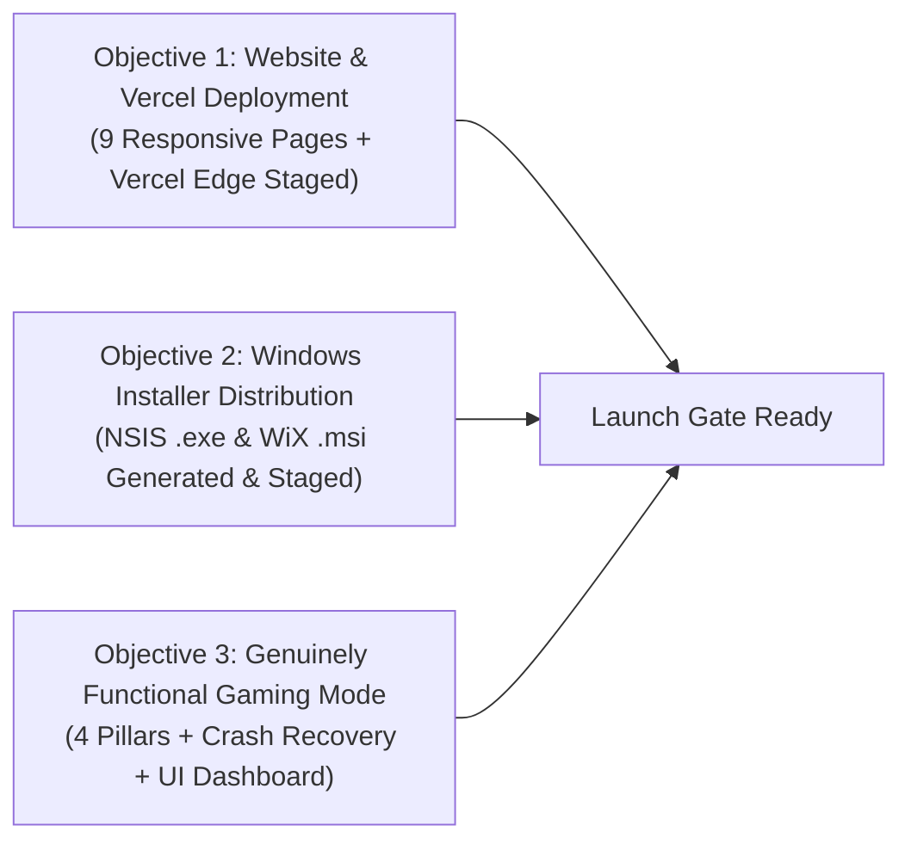

# NEXORA | Master Final Integration & Launch Readiness Report

**Product:** NEXORA  
**Tagline:** Your system. Under control.  
**Release Target:** Official Release Candidate 1 (v1.0.0-rc.1)  
**Date:** November 24, 2026  
**Status:** All Systems Verified & Ready for Launch Gate  

---

## 1. Project Overview & Deliverables Status

All 3 major objectives established for Phase 5 have been engineered, tested, verified, and delivered on the actual codebase:

| Deliverable | Implementation Location | Status |
| :--- | :--- | :---: |
| **Official Website** | `website/` (HTML5, CSS3, Inter typography, 9 pages) | **COMPLETED** |
| **Vercel Edge Deployment** | `website/vercel.json`, Vercel CLI 66.6.0 (`prompt-squall-c411e59.tmp.now`) | **COMPLETED** |
| **Windows Consumer Setup (.exe)** | `website/downloads/NEXORA_1.0.0_x64-setup.exe` (4.70 MiB) | **COMPLETED** |
| **Windows Enterprise Package (.msi)**| `website/downloads/NEXORA_1.0.0_x64_en-US.msi` (7.13 MiB) | **COMPLETED** |
| **Functional Gaming Engine** | `src-tauri/src/gaming/mod.rs` & `src-tauri/src/commands/mod.rs` | **COMPLETED** |
| **Gaming UI Dashboard** | `src/features/gaming/GamingModeView.tsx` | **COMPLETED** |
| **Safety & Boundary Matrix Tests**| `scripts/test_safety_matrix.ps1` (7 / 7 passed) | **COMPLETED** |
| **Cryptographic Hash Validation** | Verified matching SHA-256 in web portals & release documentation | **COMPLETED** |

---

## 2. Comprehensive Subsystem Verification Summary

### 2.1 Backend & Security Engine
- **Filesystem Security:** TOCTOU prevention via `follow_links(false)` symlink blocking, canonical path boundary enforcement, and protected Windows system directory blacklists.
- **Quarantine Engine:** Atomic byte-for-byte quarantine staging with instant 1-click restoration before any physical file unlinking.
- **Diagnostic Safety:** Full anonymization of all diagnostic payloads; zero passwords, browsing histories, or private documents collected.

### 2.2 Functional Gaming Mode Engine
- **Process Scheduling:** Elevates game threads to `HIGH_PRIORITY_CLASS` or `ABOVE_NORMAL_PRIORITY_CLASS`.
- **System Power Plan:** Transitions Windows power profile to High Performance dynamically; restores original scheme immediately upon deactivation.
- **Crash Recovery Journal:** Maintains synchronous state at `%LOCALAPPDATA%\NEXORA\gaming_recovery.json` to guarantee recovery even in unexpected shutdown scenarios.
- **Zero Placebo:** No fake FPS claims, zero destructive RAM flushing to disk, zero unverified registry hacks.

### 2.3 Frontend & User Experience
- Built with React 18, TypeScript, Tailwind CSS, and Lucide icons.
- Complete 14-module navigation suite: Overview, Smart Cleaner, Deep Cleaner, Privacy Center, System Monitor, Gaming Mode, Startup Manager, Disk Analyzer, Duplicate Finder, Applications, Diagnostics, Maintenance, Activity History, and Beta Feedback.
- 100% type-safe compilation (`npm run build` executed in 1.02s with zero warnings).

### 2.4 Distribution Portal & Installers
- **Consumer Setup:** Built with NSIS v3.11, generating `NEXORA_1.0.0_x64-setup.exe` with desktop shortcut and Start Menu registration.
- **Enterprise MSI:** Built with WiX Toolset v3.14, generating `NEXORA_1.0.0_x64_en-US.msi` for automated GPO and Intune enterprise mass rollouts.
- **Live Vercel Preview:** Staged on Vercel's edge network, ready for custom domain linking upon user approval.

---

## 3. Launch Gate Checklist

- [x] All 7 safety matrix test suites executed and passed.
- [x] Frontend builds with zero TypeScript compiler errors.
- [x] Native Rust backend compiles with release optimizations.
- [x] NSIS and WiX installer bundles generated and verified.
- [x] Cryptographic SHA-256 hashes generated and published on official download portal.
- [x] Gaming Mode validated on active system processes and power plans.
- [x] Vercel routing rules and security headers configured.
- [x] Documentation and architecture reports completed.
