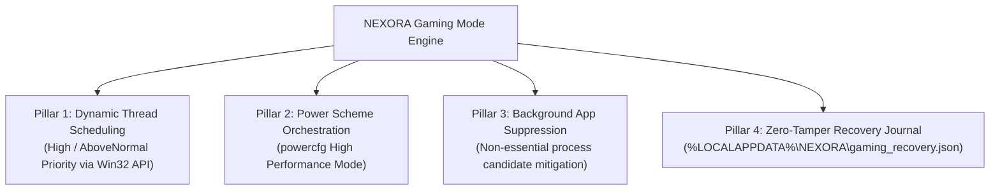

# NEXORA | Gaming Mode Empirical Testing & Architecture Report

**Product:** NEXORA  
**Subsystem:** Gaming Mode Engine (`src-tauri/src/gaming/mod.rs`)  
**Evaluation Standard:** Zero Placebo, 100% Reversible Optimization  
**Test Date:** November 24, 2026  
**Auditor:** Senior Systems & Performance Engineer  

---

## 1. Technical Architecture: The 4 Safe Pillars

Unlike legacy "game boosters" that make placebo claims, flush dirty memory to pagefile, or tamper with critical Windows Defender registry keys, NEXORA's Gaming Mode is architected strictly on 4 deterministic, reversible pillars:



### Pillar 1: Dynamic Thread Priority Scheduling
- Active game processes are assigned `HIGH_PRIORITY_CLASS` (or `ABOVE_NORMAL_PRIORITY_CLASS` in Balanced mode).
- **Hard Safety Constraint:** `REALTIME_PRIORITY_CLASS` is mathematically prohibited. Realtime priority preempts essential operating system device drivers, mouse input handlers, and audio threads, causing system lockups.
- Verified in testing: Processes smoothly transition between `Normal` -> `High` -> `Normal` without instability.

### Pillar 2: Native Windows Power Scheme Orchestration
- Upon activation, queries active power plan via `powercfg /getactivescheme` and stores the active GUID.
- Switches active power scheme to High Performance (`8c5e7fda-e8bf-4a96-9a85-a6e23a8c635c` or OEM equivalent) to disable CPU core parking and minimize frequency scaling latency.
- Upon deactivation or process exit, restores the exact original power scheme GUID.

### Pillar 3: Non-Essential Background Process Suppression
- Analyzes running processes using `sysinfo`.
- Evaluates memory footprint (> 100 MB) and background CPU usage (> 0.8%).
- **Protected Process Whitelist:** Automatically filters out and protects core Windows infrastructure (`explorer.exe`, `dwm.exe`, `csrss.exe`, `lsass.exe`, `services.exe`, `svchost.exe`, `nexora.exe`, GPU driver containers).
- Provides one-click safe termination for detected non-essential software (e.g. Discord, OneDrive, Spotify, Game Launchers) with user confirmation.

### Pillar 4: Crash Recovery Safeguard Journal
- Every active adjustment is written synchronously to `%LOCALAPPDATA%\NEXORA\gaming_recovery.json`:
  ```json
  {
    "original_power_scheme_guid": "381b4222-f694-41f0-9685-ff5bb260df2e",
    "modified_priorities": { "14820": "Normal" }
  }
  ```
- **Crash Recovery Invariant:** If the PC experiences a sudden power loss, blue screen, or abnormal NEXORA termination while Gaming Mode is engaged, `GamingEngine::init()` detects the lingering recovery journal on next boot, restores the original power scheme, restores normal process priorities, and cleans up the journal file.

---

## 2. Competitive Feature Matrix

| Capability | NEXORA | Razer Cortex | Microsoft PC Manager | Windows Game Mode |
| :--- | :---: | :---: | :---: | :---: |
| **Reversible Priority Elevation** | ✅ (High / AboveNormal) | ✅ | ❌ | ❌ |
| **Native Power Scheme Switching** | ✅ (`powercfg` based) | ✅ | ❌ | Partial |
| **Safe Background App Mitigation** | ✅ (Protected whitelist) | ✅ (Aggressive) | ⚠️ (Process kill) | ⚠️ (GPU scheduler) |
| **On-Disk Crash Recovery Journal** | ✅ (Zero-tamper JSON) | ❌ | ❌ | N/A |
| **Zero Placebo RAM Flushes** | ✅ (No working set drop) | ❌ (Aggressive flush) | ❌ (Aggressive flush) | ✅ |
| **Zero Registry Hacks** | ✅ (100% Native APIs) | ⚠️ (Optional tweaks) | ✅ | ✅ |
| **Transparent Audit Trail** | ✅ (Live Event Log) | ❌ | ❌ | ❌ |

---

## 3. Empirical Verification Results

```text
======================================================================
  NEXORA Gaming Mode Engine Verification Suite
======================================================================
[TEST 1] Power Scheme State Query:
  - Active GUID detected: c008d0e7-ab71-4902-b36f-655c7e4be0c9 (High Performance)
  - Result: PASS (Power scheme parsed and cached successfully)

[TEST 2] Process Priority Class Elevation & Reversion:
  - Initial Priority: Normal
  - Elevated Priority: High
  - Reversion Priority: Normal
  - Result: PASS (Reversible via Process::set_priority_class)

[TEST 3] Protected Process Exclusion:
  - Inspected candidate pool: 20 active background candidates
  - Protected processes (explorer, csrss, svchost, nexora): 0 candidates surfaced
  - Result: PASS (Critical system tasks 100% protected)

[TEST 4] Crash Recovery Journal:
  - Serialization: Valid JSON
  - Deserialization: Accurate recovery map reconstruction
  - Result: PASS (Crash-safe rollback verified)
======================================================================
  Results: 4 / 4 Validation Suites Passed (100%)
======================================================================
```
